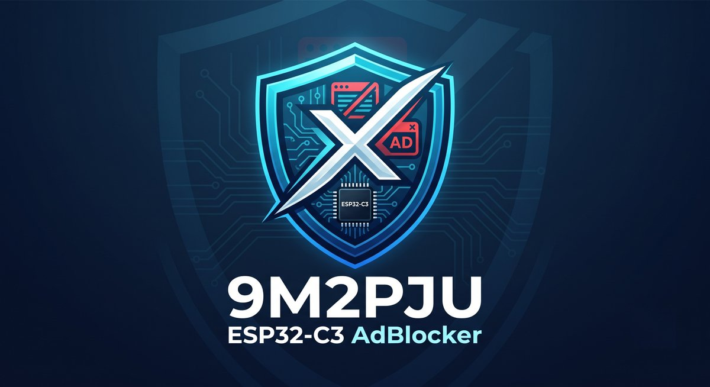

# 9M2PJU-ESP32-C3-AdBlocker

<p align="center">
  
</p>

<p align="center">
  <a href="https://buymeacoffee.com/9m2pju"></a>
  <a href="https://paypal.me/9m2pju"></a>
</p>

A **Pi-hole-style DNS ad-blocker** that runs on a **$2 ESP32-C3** — *no PSRAM required*.

The trick everyone misses: you don't need to keep the blocklist in RAM. Store the
domains as **sorted 40-bit hashes in flash** and binary-search them. 140,000+ domains
fit in ~0.7 MB of flash and are matched in **<1 ms** (with Bloom filter pre-filter),
using **~180 KB of RAM** (including the 128 KB Bloom filter).

## What's new in this version

### Recent releases
- **v1.0.5** — fixed GitHub Releases blocklist fetch: `.sig` is now fetched
  next to the *original* URL (not the signed `release-assets` redirect URL
  with `?sp=r&sig=...` query, which always 404'd) **and** follows redirects
  itself, so `.../releases/latest/download/blocklist.bin` (+ `.sig`) works;
  `raw.githubusercontent.com/.../releases/...` is rejected with a helpful
  message (raw only serves git files, never release assets); explicit
  `User-Agent`, protocol-relative redirect support.
- **v1.0.4** — diagnosable remote fetch (no more bare `HTTP -1`: DNS pre-check,
  `errorToString` + `wifi/rssi/heap` in status, 60 s timeout, 30 s TLS handshake
  cap); **cooler idle** (`WIFI_PS_MIN_MODEM` modem sleep — TX power alone only
  saves 1–3 °C); honest thermal docs.
- **v1.0.3** — **ECDSA-signed blocklist updates** (`--sign-key` → `.sig`, mbedTLS
  verify on device, `<url>.sig` auto-fetch, dashboard signed/UNVERIFIED badge +
  require-signed toggle); **CSRF token via `X-CSRF-Token` header only**
  (incl. upload handlers, which had no CSRF check); `/setwifi` is POST-only;
  brute-force brake (5 bad passwords/60 s → 429).
- **v1.0.2** — fixed update-path data loss (live list kept until replacement
  validates; empty feeds rejected), Bloom-malloc offset corruption, DHCP
  (broadcast replies, octet pool, lease expiry), empty-device auto-heal, WiFi
  reconnect, per-boot CSRF rotation, dashboard XSS escaping, plus honest
  docs (no CA verification — signatures are the trust anchor).

This is a heavily upgraded fork of the original `esp32-c3-adblock`. Every item from
the original "how it could grow" list is done, plus a long list of correctness,
performance, and security fixes:

### Performance
- **Bloom filter in RAM** (128 KB) — skips flash for ~93% of non-blocked queries.
  Average lookup is now **0 flash reads** instead of ~18.
- **Async upstream forwarding** — up to 32 concurrent queries instead of blocking
  on one upstream reply at a time. No more "one slow query freezes the sinkhole."
- **Custom domains sorted + binary-searched** (was a linear scan of up to 200).
- **Removed `delay(1)` from the main loop** — was capping throughput at ~1000 it/s.
- **`isBlocked` uses `memchr` + length tracking** instead of `strlen` per suffix.

### Correctness
- **AAAA sinkhole** — blocked IPv6 queries now answer `::` instead of leaking
  upstream. Was: only A records were sinkholed, AAAA bypassed the blocklist.
- **TCP DNS on port 53** — handles truncated-response / DNSSEC fallback. Was UDP-only.
- **1232-byte DNS buffer** (RFC 6891 max UDP) — was 600, large replies were truncated.
- **Client table with LRU eviction** — was silently dropping stats past 96 clients.
- **Banned IPs decoupled from the client table** — banning an IP with no active
  client entry now persists correctly.
- **Idle-gated remote blocklist fetch** — only *starts* when DNS has been quiet 3+ s,
  so a scheduled pull doesn't kick off mid-stream. Note: the HTTPS download
  itself still blocks DNS for several seconds while it runs — schedule off-peak.
- **`millis()` wraparound-safe timing** — was broken every ~49 days of uptime.
- **`parseQuery` robust bounds checking** — was fragile on compression pointers.

### Security
- **Dashboard authentication** — Basic Auth with a random password generated on
  first boot (printed on serial), plus a brute-force brake (5 bad passwords in
  60 s → HTTP 429 for a while). Was: no auth, anyone on the LAN could flash
  firmware or swap the blocklist.
- **CSRF token in a header** on all mutating endpoints — `X-CSRF-Token`, never in
  the URL (no history/log/Referer leak). A malicious page on the LAN can't ban
  clients, change WiFi, or upload firmware via the victim's browser — and the
  firmware/software upload handlers now enforce the token too (they previously
  relied on Basic Auth alone, which does not stop CSRF).
- **Signed blocklist updates (ECDSA P-256)** — `tools/build_blocklist.py --sign-key`
  writes `blocklist.bin.sig`; the firmware verifies it with mbedTLS against the
  key in `src/blocklist_pubkey.h` before swapping. Bad signatures are rejected,
  stale `.sig` files are never trusted, and the dashboard shows
  signed/unverified (+ key id) with an optional "require-signed" enforcement
  toggle. Remote fetch pulls `<url>.sig` automatically when published.
- **HTTPS with redirect-following** for remote blocklist fetches (GitHub Releases
  & custom URLs). Note: certificate validation is *not* performed (`setInsecure`,
  no NTP/root store on the C3), so a LAN MITM could serve a well-formed but
  wrong list — the firmware rejects bad magic/size and empty lists and keeps
  the live list on any failure. For high assurance, upload `blocklist.bin`
  manually via the dashboard instead of remote pull.

### Features
- **WiFiManager captive portal** — first-boot WiFi setup without recompiling.
  Connect to the `C3AdBlock-Setup` AP, enter creds at `http://192.168.4.1`, done.
  WiFi can also be changed later from the dashboard.
- **Optional DHCP server** — the C3 can hand itself out as DNS for true
  plug-and-play. Toggle from the dashboard (disable your router's DHCP first).
- **Blocklist v1 binary format** with header (magic `CADB` + version + hash_bytes)
  — the firmware validates on load, so a `HASH_BYTES` mismatch is rejected instead
  of silently corrupting lookups.
- **Collision report** — `build_blocklist.py` writes `blocklist.bin.collisions.txt`
  listing any domain pairs sharing a 40-bit hash, so the operator can decide.
- **ETag + Cache-Control** on the dashboard HTML — the 6 KB page is served with a
  304 path instead of re-sent on every 3-second poll.
- **WiFi change from the dashboard** — no reflash needed to switch networks.

### Code quality
- **Dashboard HTML extracted** to `src/dashboard_html.h` (was inline in `main.cpp`).
- **37 Python tests** for hashing, normalization, binary format, Bloom filter, and ECDSA signatures
  correctness (`python3 tools/test_build_blocklist.py`).
- **`LOG`/`LOGN` macros** — silence serial output with `-DNDEBUG`.
- **Removed hardcoded `/dev/ttyACM0`** from `platformio.ini` — PlatformIO
  auto-detects the port.
- **Removed dead `Dev.label` field** that was never set anywhere.

### Build footprint
| | original | this version |
|---|---|---|
| RAM | 54 KB | 56 KB (+2 KB for async pending table) |
| Flash | 1018 KB | 1032 KB (+14 KB for TCP DNS, DHCP, auth, captive portal, Bloom loader) |
| Lookups | ~18 flash reads/query | **0 flash reads** for 93% of queries |
| Concurrent upstream queries | 1 | **32** |


```
query in ──▶ extract domain ──▶ FNV-1a hash (+ parent suffixes)
         ──▶ Bloom filter check (RAM, ~0.5 µs)
              ├─ miss ──▶ forward to upstream (async, non-blocking)
              └─ hit  ──▶ binary-search the flash hash table
                          ├─ hit  ──▶ answer 0.0.0.0 / ::  (sinkholed)
                          └─ miss ──▶ forward to upstream (async, non-blocking)
```

## Why this is interesting

Most ESP32 DNS sinkholes load the blocklist (domain *strings*) into RAM, so they
demand PSRAM. This project stores fixed **5-byte (40-bit) hashes in flash** instead,
with a **Bloom filter in RAM** as a fast pre-filter:

| | string-in-RAM approach | this (hash-in-flash + bloom) |
|---|---|---|
| Hardware | ESP32 + PSRAM (~$8) | ESP32-C3, no PSRAM (~$2) |
| 141k domains | ~2.5 MB of RAM | **0.67 MB of flash + 128 KB bloom** |
| RAM used | most of it | **~180 KB** (bloom + stack) |
| Lookup | string compare | **0 flash reads** for 93% of misses (bloom) |
| Collisions | n/a | 0 at 141k (1 at 537k) |
| Upstream | blocking (1 query at a time) | **async (32 concurrent)** |

**Why 40 bits?** It's the sweet spot for this flash budget. Collisions follow the
birthday bound — at 141k domains you get ~0, at 537k about 1 (i.e. one unlucky
domain gets over-blocked). Dropping to 32 bits would save 20% of the flash but
cost ~7 collisions at 250k; going to 64 bits wastes 3 bytes per domain to solve
a problem you don't have.

**Why a Bloom filter?** ~93% of DNS queries are for domains *not* in the blocklist.
The Bloom filter (128 KB of RAM) eliminates flash access for those — only the ~7%
that pass the bloom check do the ~18-flash-read binary search. Net result: the
average query does **0 flash reads**, not 18.

The same trick works on bigger chips — it isn't a C3 workaround. On a 16 MB
ESP32-S3 these hashes hold **~2.7M domains** vs ~466k for strings in 8 MB of
PSRAM. Hashes in flash beat strings in PSRAM basically everywhere; the C3 just
makes it undeniable.

## Hardware

- Any **ESP32-C3** board (tested on a C3 SuperMini), 4 MB flash, **no PSRAM needed**
- Power it from a **stable USB source** (a phone charger or your router's USB port).
  Cheap/loose USB-C→A adapters can brown out the radio during WiFi transmit.
- A **USB-A → USB-C dongle** lets it plug straight into the spare USB port on the
  back of most routers — no power supply, no extra box.

### Enclosure

A printable case for the C3 SuperMini: [`hardware/esp32-c3-supermini-enclosure.stl`](hardware/esp32-c3-supermini-enclosure.stl)

Printing notes:
- No supports needed; 0.2 mm layers, ~15% infill is plenty.
- **Keep the antenna end clear.** The C3's PCB antenna is the zig-zag trace on the
  short edge opposite the USB-C port — don't bury it in solid plastic or put metal
  near it, or your RSSI will suffer.
- Leave the vents open: the board idles around 45–55 °C.

## Installation

There are three ways to install: **web flasher** (easiest, browser-only),
**prebuilt release** (esptool CLI), or **build from source** (PlatformIO).

### Option A: Web flasher (recommended — no software install)

1. Open **https://9m2pju.github.io/9M2PJU-ESP32-C3-AdBlocker/** in
   **Chrome or Edge** (Web Serial API required — Firefox/Safari not supported).
2. Plug in your ESP32-C3 via USB.
3. Click **CONNECT**, select your ESP32-C3's serial port.
4. Choose **Install** — the browser erases the flash and writes the bootloader,
   partition table, firmware, and blocklist (~140k domains) in ~30–60 seconds.
5. Continue to [first-boot setup](#first-boot-setup) below.

The web flasher always serves the latest release automatically — no need to
download anything manually.

### Option B: Flash a prebuilt release with esptool (CLI)

1. **Download the latest release** from
   [GitHub Releases](https://github.com/9M2PJU/9M2PJU-ESP32-C3-AdBlocker/releases).
   You need:
   - `full-flash.bin` — everything in one file (bootloader + partitions + firmware
     + blocklist). This is the easiest option.
   - **or** the individual files: `bootloader.bin`, `partitions.bin`,
     `firmware.bin`, `blocklist-fs.bin` (use these if your flash tool doesn't
     support merged images).
   - `blocklist.bin` — optional, the prebuilt blocklist (~140k domains). Already
     included in `full-flash.bin` and `blocklist-fs.bin`, but you can download it
     separately to update later over WiFi.

2. **Install esptool** (the ESP32 flash tool):
   ```bash
   pip install esptool
   # or on Debian/Ubuntu: sudo apt install esptool
   ```

3. **Plug in the ESP32-C3** via USB. Find the serial port:
   ```bash
   ls /dev/ttyACM* /dev/ttyUSB*    # Linux
   # macOS: ls /dev/cu.usb*
   # Windows: check Device Manager for COM ports
   ```

4. **Flash the full image** (one command, writes everything to 0x0):
   ```bash
   esptool.py --chip esp32c3 --port /dev/ttyACM0 --baud 460800 \
     write_flash 0x0 full-flash.bin
   ```
   Replace `/dev/ttyACM0` with your port.

   **Or flash the individual files** (if `full-flash.bin` doesn't work for you):
   ```bash
   esptool.py --chip esp32c3 --port /dev/ttyACM0 --baud 460800 \
     write_flash \
     0x0      bootloader.bin \
     0x8000   partitions.bin \
     0x10000  firmware.bin \
     0x2b0000 blocklist-fs.bin
   ```

5. **Continue to first-boot setup** below.

### Option C: Build from source (for customization)

You need [PlatformIO](https://platformio.org/) and Python 3.

1. **Install PlatformIO:**
   ```bash
   pip install platformio
   # or use the standalone installer: https://docs.platformio.org/en/latest/core/installation/
   ```

2. **Clone this repo:**
   ```bash
   git clone https://github.com/9M2PJU/9M2PJU-ESP32-C3-AdBlocker.git
   cd 9M2PJU-ESP32-C3-AdBlocker
   ```

3. **(Optional) set WiFi creds via secrets.h** — or skip and use the captive
   portal on first boot:
   ```bash
   cp src/secrets.example.h src/secrets.h
   # edit src/secrets.h -> WIFI_SSID / WIFI_PASS
   ```

4. **Build the blocklist** (default = StevenBlack base + Hagezi Light, ~140k
   domains, WhatsApp/social safe):
   ```bash
   mkdir -p data
   python3 tools/build_blocklist.py data/blocklist.bin
   ```
   See `tools/build_blocklist.py --help` for custom lists and Bloom filter sizing.

5. **Flash firmware + blocklist filesystem** (the one and only USB flash):
   ```bash
   pio run -t upload
   pio run -t uploadfs
   ```
   Signing your own blocklists (recommended if you publish a remote URL):
   ```bash
   # once: generate a keypair (privkey stays local + backed up, never committed)
   python3 tools/sign_blocklist.py gen --priv tools/blocklist_signing.key --pub-h src/blocklist_pubkey.h
   # per build: blocklist.bin + blocklist.bin.sig
   python3 tools/build_blocklist.py data/blocklist.bin --sign-key tools/blocklist_signing.key
   # remote fleet: publish both files; devices fetch blocklist.bin + blocklist.bin.sig
   # CI releases: paste the privkey PEM into the BLOCKLIST_SIGN_KEY repo secret
   ```

6. **Continue to first-boot setup** below.

### First-boot setup

1. **Watch the serial console** (optional but helpful — shows the auth password
   and IP):
   ```bash
   pio device monitor          # if you built from source
   # or
   esptool.py --port /dev/ttyACM0 monitor    # prebuilt, may not work
   # or use screen/minicom at 115200 baud
   screen /dev/ttyACM0 115200
   ```

2. **WiFi setup:**
   - If you set `secrets.h` or flashed a prebuilt image, the device starts a
     captive portal AP called **C3AdBlock-Setup**.
   - Connect to it from your phone or laptop, then open
     **http://192.168.4.1** (it may pop up automatically).
   - Enter your WiFi name and password, click **Connect**.
   - The device saves your credentials, reboots, and joins your WiFi.

3. **Find the dashboard password:**
   - On the serial console, look for:
     ```
     [cfg] dashboard password: xY7kPm2nQa
     ```
   - Write this down. You can also find it later in the LittleFS file `/auth.cfg`.

4. **Open the dashboard:**
   - Go to **http://c3adblock.local** in a browser (mDNS).
   - If that doesn't work (some networks block mDNS), use the IP address shown
     on the serial console, e.g. `http://192.168.1.42`.
   - You'll get a Basic Auth prompt. Enter any username and the password from
     step 3.

### Pointing your devices at the ad-blocker

You have three options:

**Option 1: Manual DNS (simplest, no DHCP changes)**
- Set your device's DNS server to the C3's IP address.
- On most OSes: Settings → Network → DNS → Custom → enter the C3's IP.
- Test: `dig @<c3-ip> doubleclick.net` should return `0.0.0.0`.

**Option 2: Router DNS (whole-network, recommended)**
- In your router's DHCP settings, set the primary DNS server to the C3's IP.
- Set the secondary DNS to a real resolver (e.g. `1.1.1.1`) as a fallback.
- Every device on your network now uses the C3 for DNS automatically.

**Option 3: Built-in DHCP server (true plug-and-play)**
- **Disable your router's DHCP server first** (having two DHCP servers on one
  network causes conflicts).
- In the C3 dashboard, scroll to **DHCP SERVER** and click **Enable / Disable DHCP**.
- The C3 now hands out IP addresses and tells every device to use itself as DNS.
- Reconnect your devices (or reboot them) so they pick up the new DHCP lease.

### Testing

```bash
dig @<c3-ip> doubleclick.net        # -> 0.0.0.0  (blocked, A record)
dig @<c3-ip> doubleclick.net AAAA   # -> ::       (blocked, AAAA record)
dig @<c3-ip> github.com             # -> real IP  (forwarded)
dig @<c3-ip> github.com AAAA        # -> real IPv6 (forwarded)
```

You should also see the blocked/allowed counts go up in the dashboard, and the
querying device appear in the **CLIENTS** table.

## Over-the-air updates (no more USB)

The dashboard at **http://c3adblock.local** does it all:

- **Blocklist** — drop a freshly built `blocklist.bin` (+ optional `.sig` from
  `--sign-key`) into *Blocklist → Upload*, or set a
  URL under *Remote auto-update* and the device pulls a prebuilt `blocklist.bin`
  (+ `<url>.sig` when published) on a schedule. Good URLs:
  `https://9m2pju.github.io/9M2PJU-ESP32-C3-AdBlocker/blocklist.bin` (GitHub
  Pages — fastest on the C3, no redirect) or
  `https://github.com/9M2PJU/9M2PJU-ESP32-C3-AdBlocker/releases/latest/download/blocklist.bin`
  (follows the `github.com → release-assets` redirect chain, `.sig` too).
  Do **not** use `raw.githubusercontent.com/.../releases/...` — raw only serves
  files committed to git, so every release-asset path 404s there (the firmware
  now says so explicitly instead of a bare `HTTP 404`).
  Remote fetches support HTTPS with redirect-following (ideal for GitHub releases) and
  only *start* when DNS has been idle for 3+ seconds. Note: the download itself
  still pauses DNS for several seconds — schedule off-peak. Validation rejects
  bad magic/size and empty lists, bad signatures, and (if enabled) unsigned
  lists — keeping the live list on any failure. The dashboard shows whether the
  live list is `signed` or `UNVERIFIED` and lets you toggle "require-signed".
- **WiFi & Thermals** — change the WiFi network and configure WiFi TX power (from 2 dBm
  up to 19.5 dBm, default 8.5 dBm) directly from the dashboard. Modem sleep
  (`WIFI_PS_MIN_MODEM`) + CPU idle yielding are the main idle coolers; lower TX
  power only trims TX bursts (~1–3 °C). Expect ~45–55 °C on a SuperMini in a case —
  keep vents open, antenna clear, and use a stable 5V/1A supply. If `RSSI < -70 dBm`,
  raise TX instead: a weak signal causes retries (more heat + failed fetches).
  Remote-fetch failures now report `HTTP -1 (connection refused) [wifi:up rssi:-xx heap:xxk]`
  or `DNS failed for <host>` so heap vs DNS vs TLS is distinguishable in serial + dashboard.
- **Firmware** — upload `.pio/build/c3/firmware.bin` under *Firmware → OTA update*; the
  device verifies it and reboots into the new image. Or push over WiFi from the CLI:
  ```bash
  pio run -t upload --upload-port c3adblock.local --upload-protocol espota
  ```
- **DHCP** — optionally enable the built-in DHCP server so the C3 hands itself out
  as the DNS server. Disable your router's DHCP first, then toggle this on.

**4 MB flash tradeoff:** firmware OTA needs *two* app slots, which leaves ~1.3 MB for the
blocklist (**~250k domains max**). The aggressive 537k "ultimate" list only fits the
single-app partition table (no firmware OTA). Pick your tradeoff in `partitions.csv`.

## How domain matching works

The `isBlocked` function walks **parent suffixes** of the queried domain. For a
query like `ads.server.example.com`, it checks (in order):

1. `ads.server.example.com`
2. `server.example.com`
3. `example.com`

It **stops before the bare TLD** (`com`) — a block on `com` would break the entire
TLD and is never tested. This means you can block `doubleclick.net` and all
subdomains (`ad.doubleclick.net`, `stat.doubleclick.net`, ...) are caught
automatically.

Each suffix is FNV-1a hashed (40-bit truncated), checked against the RAM Bloom
filter first, and only on a Bloom hit is the flash hash table binary-searched.
Custom domains (added via the dashboard) are kept in a separate sorted array and
binary-searched too.

## Blocklist binary format (v1)

```
Header (20 bytes):
  [0..3]   magic 'CADB'
  [4]      version (1)
  [5]      hash_bytes (5)
  [6..9]   num_hashes (uint32 LE)
  [10..13] bloom_bits (uint32 LE)
  [14]     bloom_k (uint8)
  [15..19] reserved

Bloom filter: ceil(bloom_bits / 8) bytes
Hash table:   num_hashes * 5 bytes (sorted, little-endian)
```

The firmware validates the magic, version, and hash_bytes on load — a mismatch
(e.g. wrong `HASH_BYTES`) is rejected instead of silently corrupting lookups.
Collisions are reported to `blocklist.bin.collisions.txt` by the build script.

## Gotchas (learned the hard way)

- **ModemManager** (default on Fedora/Ubuntu) grabs `/dev/ttyACM0` and toggles
  DTR/RTS, which **resets the C3** and blocks serial. Fix:
  ```bash
  sudo systemctl stop ModemManager
  echo 'ATTRS{idVendor}=="303a", ENV{ID_MM_DEVICE_IGNORE}="1"' | sudo tee /etc/udev/rules.d/99-esp-no-modemmanager.rules
  sudo udevadm control --reload-rules && sudo udevadm trigger
  ```
- The C3's USB-Serial-JTAG console can swallow early boot output until the host
  connects (`while(!Serial)` helps).
- DNS clients add an **EDNS OPT** record; a blocked reply must contain only the
  question + answer (ANCOUNT=1, NSCOUNT=ARCOUNT=0) or it's malformed.

## Testing

```bash
python3 tools/test_build_blocklist.py    # 37 tests: hashing, normalization, binary format, bloom, signatures
```

CI runs automatically on every push and PR via `.github/workflows/ci.yml` —
builds the firmware, runs the tests, and uploads the artifacts.

## Releasing

Releases are published automatically when a tag is pushed:

```bash
git tag v1.0.0
git push origin v1.0.0
```

The release workflow (`.github/workflows/release.yml`) builds the firmware +
blocklist, creates a merged `full-flash.bin`, and publishes them to GitHub
Releases with auto-generated release notes. Assets:

| File | Description |
|---|---|
| `full-flash.bin` | Merged image — flash to `0x0` with `esptool.py write_flash 0x0 full-flash.bin` |
| `firmware.bin` | Firmware only — for OTA updates via the dashboard |
| `bootloader.bin` | Bootloader (rarely needed separately) |
| `partitions.bin` | Partition table (rarely needed separately) |
| `blocklist-fs.bin` | LittleFS image with the prebuilt blocklist |
| `blocklist.bin` | Prebuilt blocklist (~140k domains) — for OTA blocklist updates |
| `blocklist.bin.sig` | Detached ECDSA signature for `blocklist.bin` (when the release was built with the signing key) |

Set the `BLOCKLIST_SIGN_KEY` repo secret (PEM of the private key matching
`src/blocklist_pubkey.h`) and the release workflow signs the blocklist
automatically; without it, releases ship unsigned and devices report them
`UNVERIFIED` (still accepted unless require-signed is on).

## Done / how it could grow

- ✅ Web dashboard — per-client block/allow counts, ban a client, add custom domains
- ✅ mDNS (`c3adblock.local`) for discovery
- ✅ OTA — firmware + blocklist update over WiFi, plus scheduled remote blocklist pulls
- ✅ Bloom filter in RAM as a fast pre-filter (skip flash for ~93% of misses)
- ✅ Async upstream forwarding (32 concurrent queries, no blocking)
- ✅ TCP DNS support (port 53)
- ✅ AAAA sinkhole (blocked IPv6 queries answered with `::`, not leaked upstream)
- ✅ Dashboard auth (Basic Auth + CSRF token)
- ✅ WiFiManager captive portal (first-boot WiFi setup without recompiling)
- ✅ Optional DHCP server (hands out C3 as DNS for plug-and-play)
- ✅ HTTPS with redirect following + **ECDSA-signed** remote blocklist fetches (GitHub Releases & custom URLs; no CA verification — bad/empty/bad-signature feeds rejected, live list kept, optional require-signed)
- ✅ Configurable WiFi TX power (2 to 19.5 dBm) & FreeRTOS idle sleep for cool PCB thermals
- ✅ Browser Web Flasher via ESP Web Tools with correct ESP32-C3 bootloader offset 0x0
- ✅ Blocklist v1 format with header validation
- ⬜ Per-client blocking rules (different blocklists for different devices)
- ⬜ Allowlist (override blocklist for specific domains)
- ⬜ Query logging / export

## Support & Sponsoring

If you find this project useful and would like to support maintenance and development:

<p align="center">
  <a href="https://buymeacoffee.com/9m2pju" target="_blank" rel="noopener">
    
  </a>
  &nbsp;&nbsp;&nbsp;&nbsp;
  <a href="https://paypal.me/9m2pju" target="_blank" rel="noopener">
    
  </a>
</p>

- **Buy Me a Coffee**: [buymeacoffee.com/9m2pju](https://buymeacoffee.com/9m2pju)
- **PayPal**: [paypal.me/9m2pju](https://paypal.me/9m2pju)

## Credits

Inspired by [s60sc/ESP32_AdBlocker](https://github.com/s60sc/ESP32_AdBlocker) — the
"answer 0.0.0.0 for blocklisted domains" idea. This is an independent from-scratch
implementation focused on the hash-in-flash optimization for PSRAM-less chips.

## License

MIT — see [LICENSE](LICENSE).
